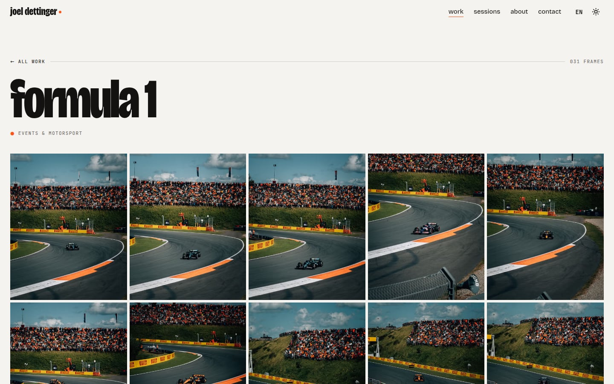

<!-- portfolio:date=2025-09-07 -->
# Photography Portfolio & Client Portal

**[English](README.md) · [Deutsch](README.de.md)**

<p align="center"></p>

Fotografie-Portfolio und Kundenportal in einer Next.js-App: Lightroom-Exporte in Nextcloud werden zur öffentlichen Website und zu privaten Kundengalerien, verwaltet über ein eingebettetes Payload CMS und per Webhooks synchronisiert.

## Highlights

- **Ingest-Pipeline von Nextcloud zur Website** — WebDAV-Webhooks mit Debounce pro Ordner plus ein 15-Minuten-Abgleich machen aus Exporten AVIF/WebP-Größen (sharp), Unschärfe-Platzhalter, Dominanzfarben und EXIF-Metadaten ohne GPS; Nextcloud-Datei-IDs halten Neu-Exporte als Versionen fest.
- **Der ganze Kundenablauf in einem Portal** — passwortlose Anmeldung per E-Mail-Link mit HMAC-signiertem Session-Cookie, Angebote mit Anzahlung, Auswahl auf Vorschauen mit Wasserzeichen samt Favoriten und verorteten Notizen, Korrekturrunden mit Vorher/Nachher-Regler und fertige Fotos für 12 Monate mit gestreamten ZIP-Downloads.
- **Zahlungen mit Stripe** — Checkout für Anzahlung und Restzahlung, signaturgeprüfte Webhooks, die jedes Ereignis nur einmal verarbeiten, Zahlungsstatus, die nur vorwärts gehen, und Downloads erst nach beglichener Restzahlung.
- **Installierbare PWA** — Serwist Service Worker, Web Push (VAPID), ein Android-Teilen-Ziel ins Handy-Studio des Fotografen, offline gespeicherte Galerien und Favoriten, die sich bei wiederhergestellter Verbindung synchronisieren.
- **Teilen und Einwilligung** — Gast-Links per Token mit optionalen Downloads in Webgröße, Veröffentlichungs-Einwilligung pro Foto und Kundenbewertungen, die erst nach Freigabe öffentlich werden.
- **Zweisprachig und selbst gehostet** — Englisch und Deutsch mit next-intl; ein Verfügbarkeitskalender aus Projektterminen und einem optionalen iCal-Feed; Payload-Migrationen laufen beim Start in einem Docker-Image aus GitHub Actions.

## Screenshots

<p align="center">
  
  
</p>

## Architektur

```
Lightroom ──Export──▶ Nextcloud ──Webhook / 15-Min-Abgleich──▶ Sync-Warteschlange
                                                                   │ sharp: AVIF/WebP-Größen, Wasserzeichen, Metadaten
                                                                   ▼
                       PostgreSQL ◀── Payload CMS (Local API) ◀── Next.js-15-App ──▶ Medienspeicher
                                                                   │
                    Website · Kundenportal · /studio · /admin · Stripe · SMTP · Web Push
```

- **Öffentliche Website:** Fotostream mit Genre-Filtern, Serienseiten, teilbarer Vollbildansicht pro Foto, FAQ, interaktivem Shooting-Planer und Kontaktstrecke.
- **Kundenportal (`/c`) & Studio (`/studio`):** Phasenbasierte Kundenbereiche (Planung, Auswahl, Korrekturen, Finale) kombiniert mit einer mobiloptimierten Studio-Inbox, Nextcloud-Uploads und 12-Monats-Statistiken.
- **Ein-Prozess-Persistenz:** Payload CMS 3 läuft direkt in Next.js über die Local API mit PostgreSQL, getrennt in Speicherpfade für Portfolio, Vorschauen mit Wasserzeichen und finale Dateien.

## Tech-Stack

Next.js 15 · React 19 · TypeScript · Node.js 22 · Payload CMS 3 · PostgreSQL · Tailwind CSS · next-intl · sharp · PWA (Serwist) · Stripe · Web Push · Nextcloud (WebDAV) · Docker · GitHub Actions

## Einrichtung

```bash
cp .env.example .env.local            # PostgreSQL, Payload, Nextcloud & optional Stripe/SMTP eintragen
docker compose up -d pg-photography   # PostgreSQL auf Port 5433 starten
npm install
npm run dev                           # http://localhost:3000 (Payload Admin unter /admin)
```

Mit `SYNC_DISABLED=true` startet die App auch lokal ohne laufende Nextcloud-Instanz; Datenbank-Migrationen laufen beim Serverstart automatisch (neue Migrationen über `npm run migrate:create <name>`).
