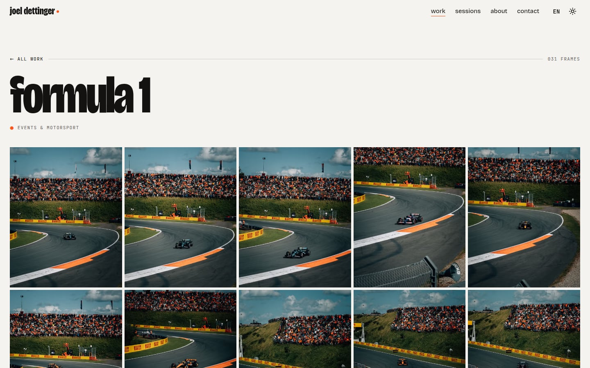

<!-- portfolio:date=2025-09-07 -->
# Photography Portfolio & Client Portal

**[English](README.md) · [Deutsch](README.de.md)**

<p align="center"></p>

A photography portfolio and client portal in one Next.js app: Lightroom exports dropped into Nextcloud become the public site and private client galleries, managed through an embedded Payload CMS and synced by webhooks.

## Highlights

- **Nextcloud → website ingest pipeline** — WebDAV webhooks with a per-folder debounce plus a 15-minute reconcile turn exports into AVIF/WebP sizes (sharp), blur placeholders, dominant colours and GPS-free EXIF metadata; Nextcloud file IDs keep re-exports as versions.
- **The whole client workflow in one portal** — passwordless email-link sign-in with an HMAC-signed session cookie, proposals with a deposit, proofing on watermarked previews with picks and pinned notes, revision rounds with a before/after slider, and finals online for 12 months with streamed ZIP downloads.
- **Payments with Stripe** — Checkout for deposit and balance, signature-verified webhooks processed once per event, payment states that only move forward, and final downloads held back until the balance is settled.
- **Installable PWA** — Serwist service worker, Web Push (VAPID), an Android share target into the photographer's phone studio, galleries saved for offline viewing and picks that sync when the connection returns.
- **Sharing and consent** — token-based guest links with optional web-size downloads, per-photo publication consent, and client reviews that go public only after approval.
- **Bilingual and self-hosted** — English and German via next-intl; an availability calendar from project dates and an optional iCal feed; Payload migrations run on startup in a Docker image built by GitHub Actions.

## Screenshots

<p align="center">
  
  
</p>

## Architecture

```
Lightroom ──export──▶ Nextcloud ──webhook / 15-min reconcile──▶ sync queue
                                                                   │ sharp: AVIF/WebP sizes, watermark, metadata
                                                                   ▼
                       PostgreSQL ◀── Payload CMS (Local API) ◀── Next.js 15 app ──▶ media storage
                                                                   │
                     public site · client portal · /studio · /admin · Stripe · SMTP · Web Push
```

- **Public site:** Photo stream with genre filters, series pages, shareable single-photo fullscreen viewer, FAQ, interactive shoot planner, and contact flow.
- **Client portal (`/c`) & Studio (`/studio`):** Stage-driven client workspaces (planning, proofing, revisions, finals) paired with a phone-first studio inbox, Nextcloud uploads, and 12-month analytics.
- **Single-process persistence:** Payload CMS 3 runs in-process inside Next.js via its Local API backed by PostgreSQL, with separate image roots for portfolio photos, watermarked proofs, and final exports.

## Tech Stack

Next.js 15 · React 19 · TypeScript · Node.js 22 · Payload CMS 3 · PostgreSQL · Tailwind CSS · next-intl · sharp · PWA (Serwist) · Stripe · Web Push · Nextcloud (WebDAV) · Docker · GitHub Actions

## Getting Started

```bash
cp .env.example .env.local            # Configure PostgreSQL, Payload, Nextcloud & optional Stripe/SMTP
docker compose up -d pg-photography   # Start PostgreSQL on port 5433
npm install
npm run dev                           # http://localhost:3000 (Payload Admin at /admin)
```

Set `SYNC_DISABLED=true` to run locally without a live Nextcloud instance; schema migrations run automatically on server startup (create migrations via `npm run migrate:create <name>`).
