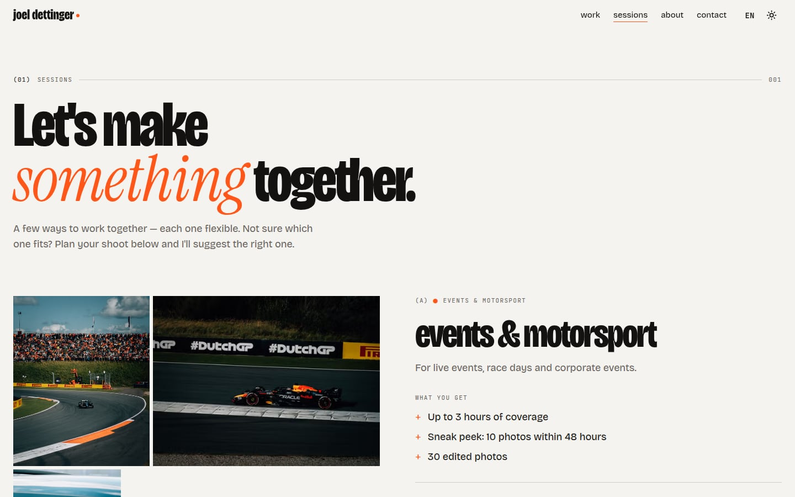

<!-- portfolio:date=2025-09-07 -->
# Photography Portfolio & Client Portal

**[English](README.md) · [Deutsch](README.de.md)**

<p align="center"></p>

A photography portfolio and client portal in one Next.js app: Lightroom exports dropped into Nextcloud become the public site and private client galleries, managed through an embedded Payload CMS and synced by webhooks.

## Highlights

- **Nextcloud → website ingest pipeline** — WebDAV webhooks with a per-folder debounce plus a 15-minute reconcile turn exports into AVIF/WebP sizes (sharp), blur placeholders, dominant colours and GPS-free EXIF metadata; Nextcloud file IDs keep re-exports as versions.
- **The whole client workflow in one portal** — passwordless email-link sign-in with an HMAC-signed session cookie, proposals with a deposit, proofing on watermarked previews with picks and pinned notes, revision rounds with a before/after slider, and finals online for 12 months with streamed ZIP downloads.
- **Payments with Stripe** — Checkout for deposit and balance, signature-verified webhooks processed once per event, payment states that only move forward, and final downloads held back until the balance is settled.
- **Installable PWA** — Serwist service worker, Web Push (VAPID), an Android share target into the photographer's phone studio, galleries saved for offline viewing and picks that sync when the connection returns.
- **Sharing and consent** — token-based guest links with optional web-size downloads, per-photo publication consent, and client reviews that go public only after approval.
- **Bilingual and self-hosted** — English and German via next-intl; an availability calendar from project dates and an optional iCal feed; Payload migrations run on startup in a Docker image built by GitHub Actions.

<p align="center">
   
</p>

## What is inside

**Public site** — home with a photo stream and genre filter, series pages, one shareable page per photo with a fullscreen viewer, an about page with FAQ, a sessions page with a step-by-step shoot planner and contact.

**Client portal (`/c`)** — one page per project with the current stage and next step, planning (questions, schedule, shot list, moodboard), selection, delivered photos, change requests, messages, review and per-photo consent.

**Studio (`/studio`)** — a phone-friendly admin view: inbox for messages, inquiries, change requests and reviews; projects by stage; uploads into Nextcloud; statistics for the last 12 months.

## Architecture

```
Lightroom ──export──▶ Nextcloud ──webhook / 15-min reconcile──▶ sync queue
                                                                   │ sharp: AVIF/WebP sizes, watermark, metadata
                                                                   ▼
                       PostgreSQL ◀── Payload CMS (Local API) ◀── Next.js 15 app ──▶ media storage
                                                                   │
                     public site · client portal · /studio · /admin · Stripe · SMTP · Web Push
```

- **Single process.** Payload 3 runs inside the Next.js app; pages and API routes use its Local API, so there is no separate CMS service.
- **Three image roots.** Portfolio photos, watermarked client previews and finals are stored apart; private images are only served to the project's clients or to admins.
- **Storage as the source of truth.** Photos live in Nextcloud; the site keeps regenerable derivatives, so a lost cache is rebuilt by the next sync.
- **Background work in the app.** A serial sync queue and a housekeeping loop handle gallery expiry reminders, purges, review invitations and payment reconciliation.

## Tech stack

Next.js 15 · React 19 · TypeScript · Payload CMS 3 · PostgreSQL · Tailwind CSS · next-intl · sharp · Serwist (PWA) · Stripe · Web Push · Nextcloud (WebDAV) · Docker · GitHub Actions

## Run locally

Requirements: Node.js 22 and Docker.

```bash
cp .env.example .env.local            # fill in the values you need
docker compose up -d pg-photography   # PostgreSQL on port 5433
npm install
npm run dev                           # http://localhost:3000, admin at /admin
```

Set `POSTGRES_URL` to the local database and `PAYLOAD_SECRET` to a long random string. Point the Nextcloud settings at your own instance, or set `SYNC_DISABLED=true` to run without photo sync; emails need the SMTP settings. Stripe and Web Push stay off until their keys are set. Schema changes go through `npm run migrate:create <name>`; migrations are applied when the server starts.
